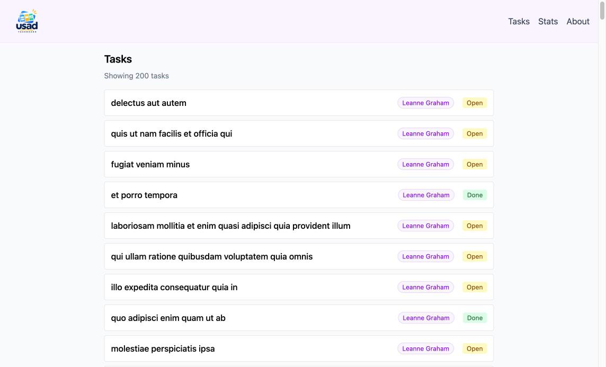
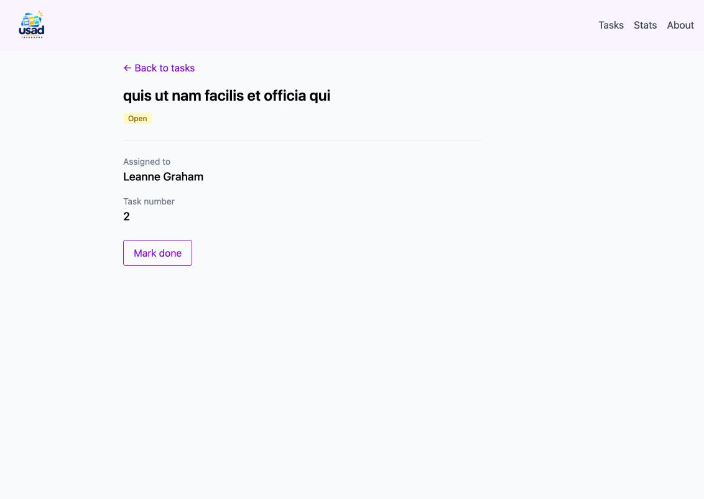
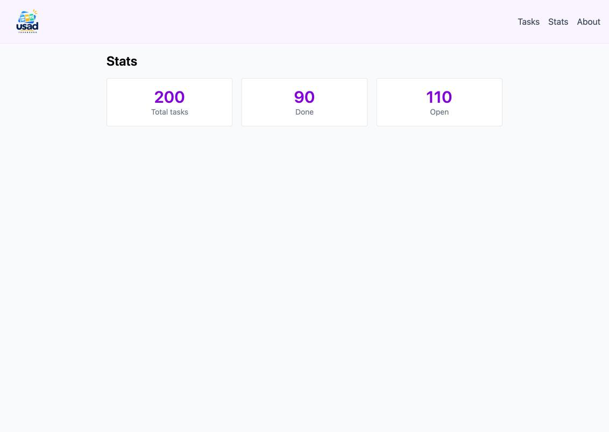
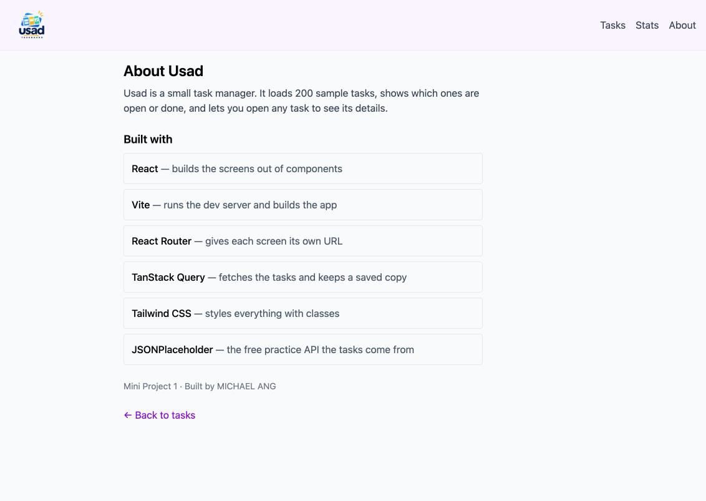
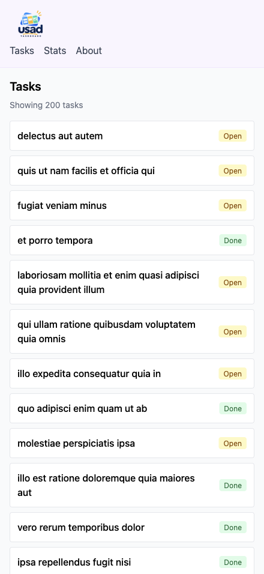
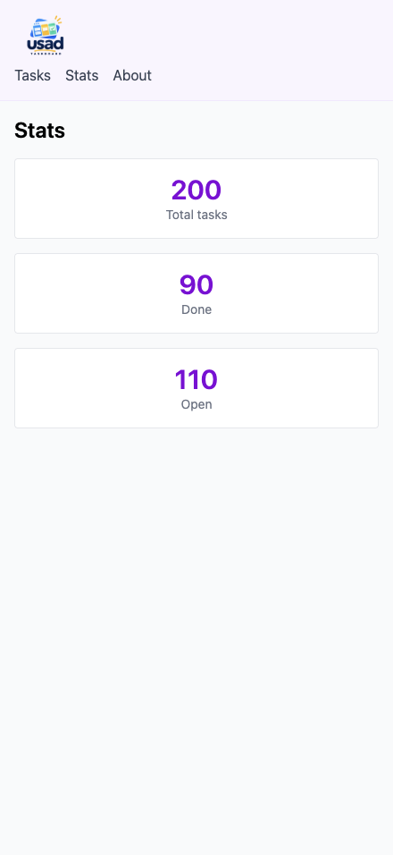
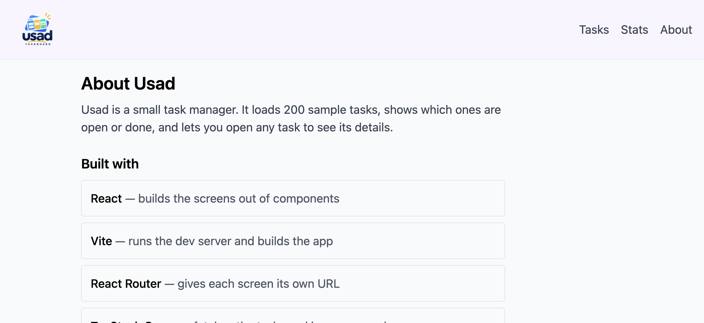

# Usad

Usad is a multi-page task manager built with React. It loads 200 sample tasks from a public API, shows which are open or done, and lets you open any task to see its details and who it's assigned to.

**Live demo:** https://mini-project-1-react-task-manager.vercel.app


## Features

### Routes

| Route | What it shows |
|---|---|
| `/` | **Tasks:** all 200 tasks with the assigned user's name and an Open / Done badge. Click a title to open it |
| `/tasks/:id` | **Task detail** (dynamic route): reads `id` with `useParams()` and shows that task's title, status, assigned user and task number, with a "Mark done" button |
| `/stats` | **Stats:** total, done and open counts, worked out from the task list |
| `/about` | **About:** what the app is and what it's built with |

### Public API

[JSONPlaceholder](https://jsonplaceholder.typicode.com), a free fake REST API:

- `GET /todos`: all tasks (Tasks and Stats pages)
- `GET /todos/:id`: one task (Task detail page)
- `GET /users/:id`: the assigned user's name (Tasks and Task detail pages)

### TanStack Query

All server data is fetched with `useQuery`. There is no `useEffect` + `useState` fetching.

| Query key | Used on | Fetches |
|---|---|---|
| `['todos']` | Tasks, Stats | All tasks. **Shared**: opening Stats after Tasks shows the numbers instantly from the cache |
| `['todo', id]` | Task detail | One task. Each task is cached separately |
| `['user', userId]` | Tasks, Task detail | One user's name.  200 rows need only 10 downloads (one per user), and the detail page reuses them |

Every page that fetches data handles loading and error from `useQuery`, and the Tasks and Stats pages also handle an empty list:

- **Loading** (`isLoading`): pulsing placeholder bars / "Loading…" text
- **Error** (`isError`): a red message box. TanStack Query retries 3 times first (about 7 seconds)
- **Empty** (`todos.length === 0`): "No tasks found." / "No tasks to count yet."

#### See each state

| State | How to see it |
|---|---|
| Loading | Chrome DevTools → Network → **Slow 4G** → refresh |
| Error | In `src/api/todos.js` set `FORCE_STATE = 'error'` → refresh (or DevTools → Network → **Offline**). Detail page: open `/tasks/999` |
| Empty | In `src/api/todos.js` set `FORCE_STATE = 'empty'` → refresh |

Set `FORCE_STATE` back to `null` afterwards.

### Screenshots

| Tasks (`/`) | Task detail (`/tasks/2`) |
|---|---|
|  |  |

| Stats (`/stats`) | About (`/about`) |
|---|---|
|  |  |

**Mobile** (iPhone 16 Pro Max, 440 × 956)

| Tasks, portrait | Stats, portrait |
|---|---|
|  |  |

**Landscape** (956 × 440): the top bar switches to one row



## Setup

Requires [Node.js](https://nodejs.org) 20.19+ or 22.12+ (needed by Vite).

```bash
git clone https://github.com/mikerang/mini-project-1-react-task-manager.git
cd mini-project-1-react-task-manager
npm install
npm run dev
```

Then open the address shown in the terminal (usually http://localhost:5173).

Other commands:

- `npm run lint`: check the code with ESLint
- `npm run build`: build for production into `dist/`

## Tech stack

React, React Router, TanStack Query, Tailwind CSS, Vite, ESLint.

## Live demo (stretch)

Deployed on Vercel: **https://mini-project-1-react-task-manager.vercel.app**

`vercel.json` rewrites every path to `index.html`, so direct links and refreshes on routes like `/stats` or `/tasks/2` work.
